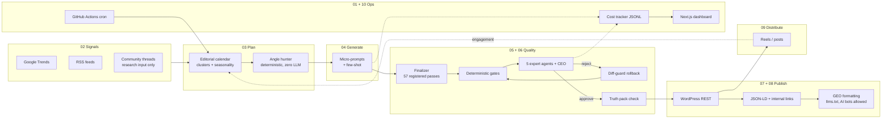

# Build an AI Content Engine: the playbook from a pipeline that shipped

> A free, code-backed course on building an autonomous AI content pipeline: sourcing, generation, quality gates, anti-hallucination, SEO, GEO (answer-engine optimization), social video, cost tracking. Every module is taken from **FlashVoyage**, a French travel-content engine one person built, ran in production, measured, and then shut down. The post-mortem is included, numbers and all.

Most "AI content automation" guides are a funnel for a SaaS. This one has no product to sell. It is the write-up of a real system: two repos (the pipeline is private, the dashboard is public), roughly 12k lines of Node.js, 17 GitHub Actions workflows, a Next.js control dashboard, and 300 logged generation runs. It produced well-structured articles cheaply. It did not produce a business. Both halves are worth learning from.

---

## 🎯 What you'll learn

- How to orchestrate a multi-step LLM pipeline with nothing but **GitHub Actions cron** and JSON files committed to the repo
- How to **source topics from signals** (Google Trends, RSS, community threads used strictly as research input)
- How to turn a topic into an **angle** with deterministic code, before any LLM call
- How to split generation into **micro-prompts** with few-shot examples, and pick models with data instead of vibes
- How to build **quality gates**: deterministic pre-checks, a weighted **multi-agent review panel**, surgical rewrites, and a **diff-guard** that rolls back bad rewrites
- How to fight hallucination with a **truth pack** (a whitelist of facts present in the source)
- How to ship **SEO plumbing**: internal links, JSON-LD, indexing pings
- How to optimize for **AI answer engines (GEO)**: extractable answers, llms.txt, letting AI crawlers in
- How to auto-produce **short vertical videos** and social posts from articles
- How to **track every token and cent**, per step and per model
- And, the most useful part: **why it still failed**, and what to check before you build one

## 🧭 Architecture at a glance

## 📚 Course modules

| # | Module | What you get | Time |
|---|---|---|---|
| 01 | [Architecture & orchestration](01-architecture-and-orchestration/) | Cron-driven pipeline, git as the database, feature flags | 30 min |
| 02 | [Sourcing signals](02-sourcing-signals/) | Trends + RSS scoring, research-only use of communities | 25 min |
| 03 | [Editorial calendar & angle hunting](03-editorial-calendar-and-angles/) | Clusters, seasonality, deterministic angles | 30 min |
| 04 | [Generation with LLMs](04-generation-with-llms/) | Micro-prompts, few-shot, model comparison | 40 min |
| 05 | [Quality gates & review panel](05-quality-gates-and-review-panel/) | Weighted agents, early exit, diff-guard | 45 min |
| 06 | [Anti-hallucination & live data](06-anti-hallucination-and-live-data/) | Truth pack, warn vs block rules, cached enrichment | 40 min |
| 07 | [SEO, internal links, JSON-LD](07-seo-internal-links-json-ld/) | Schema builder, link caps, indexing | 30 min |
| 08 | [GEO: optimizing for AI answer engines](08-geo-answer-engines/) | Extractability, llms.txt, AI crawler access | 40 min |
| 09 | [Social distribution](09-social-distribution/) | Article to reel, hook validation, what the numbers said | 30 min |
| 10 | [Cost tracking & dashboard](10-cost-tracking-and-dashboard/) | Per-step cost ledger, GitHub-backed dashboard | 30 min |
| 11 | [Post-mortem](11-post-mortem/) | What worked, what didn't, why it was stopped | 25 min |
| 🧰 | [Templates](templates/) | Small, dependency-free starter files | n/a |
| ❓ | [FAQ](FAQ.md) | Short answers to the obvious questions | 5 min |

Total: about 6 hours if you read everything and do the exercises.

## 📊 Real numbers (all from source files, nothing rounded up)

| Metric | Value | Source |
|---|---|---|
| Commits on the private pipeline repo | ~1,976, most by the bot (1,353 by `github-actions[bot]`, 596 by the author) | GitHub API, queried 2026-10-30 |
| Pipeline size | ~12k lines of Node.js | archive README |
| GitHub Actions workflow files | 17 | `.github/workflows/` |
| Registered finalizer passes | 57 | `finalizer-pass-registry.js` |
| Generation runs logged | 300 (2026-02-23 to 2026-04-17), 108 distinct article IDs | `cost-history.jsonl` |
| Total LLM spend over those runs | $20.18 | `cost-history.jsonl`, archive README |
| Median run | $0.066, 18 LLM calls, ~42.7k tokens, 5.6 min | `cost-history.jsonl` |
| Review panel scores (46 scored runs, 2026-03-17 to 03-23) | 83.8 to 96.5, median 93.35; 45 of 46 approved | `cost-history.jsonl` |
| Articles live at archive time | 38 (101,620 words), down from 140 in April 2026 | archive README |
| GEO dry-run over 37 articles | average extractability score 63.4 to 74.2, 33 improved, 0 regressed | project notes, 2026-06-11 |
| Social at archive time | Instagram 3 followers, Facebook 6, TikTok 29 | dashboard snapshot, 2026-10-25 |
| Affiliate revenue | 0 EUR year to date | Travelpayouts snapshot, 2026-10-25 |

Read that table twice. Cheap, high-scoring, technically sound, and commercially zero. [Module 11](11-post-mortem/) explains why.

## 🔗 Source code

Everything here is distilled from two repositories:

- **Pipeline:** the original pipeline repo (private, French; Node.js ESM)
- **Dashboard:** [peterbono/flashvoyage-dashboard](https://github.com/peterbono/flashvoyage-dashboard) (Next.js, TypeScript)

Code excerpts in the modules are trimmed, comments are translated to English, and site URLs, IDs and credentials are replaced with placeholders. Each excerpt names the file it comes from in the original repo.

## 👤 Who built this

**Florian Gouloubi**, Product Designer and design engineer. He designed, coded, operated and shut down FlashVoyage alone, using AI coding assistants as collaborators.

- Portfolio: [floriangouloubi.com](https://floriangouloubi.com)
- LinkedIn: [linkedin.com/in/floriangouloubi](https://www.linkedin.com/in/floriangouloubi)

## ⭐ If this helped

Star the repo so other builders find it, and open an issue if a module is unclear or a number looks wrong. Corrections with a source are very welcome.

## 📄 License

[MIT](LICENSE), covering both the text and the code snippets. Use it, fork it, teach with it; keep the copyright notice.
